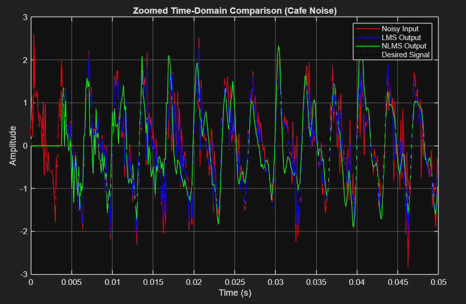
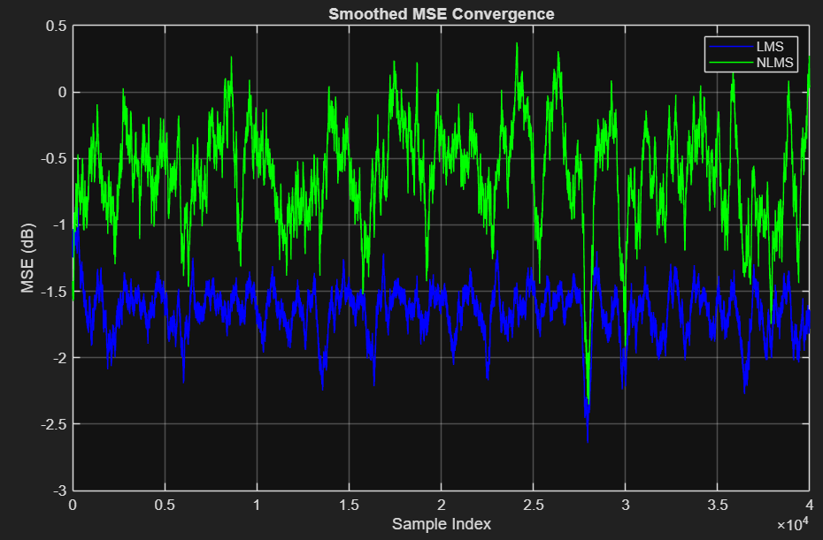
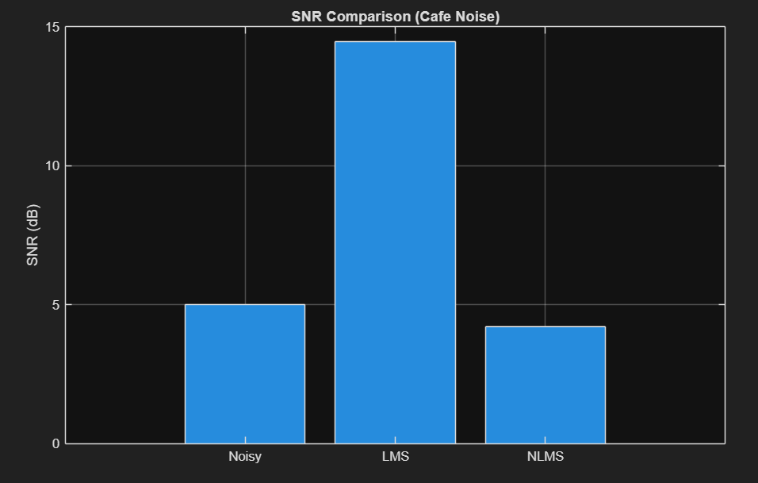
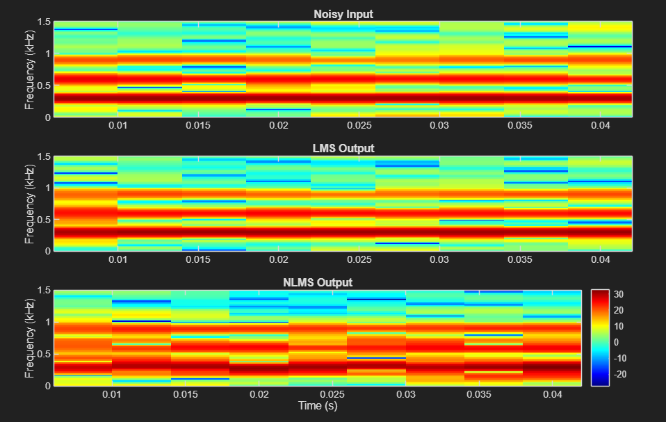

# Adaptive Noise Cancellation Using LMS and NLMS

A MATLAB implementation and comparison of **Least Mean Squares (LMS)** and **Normalized Least Mean Squares (NLMS)** adaptive filters for noise cancellation.

I built this project to explore how an adaptive FIR filter can estimate and remove noise without knowing its characteristics in advance. The system receives a primary signal containing the desired waveform plus noise, along with a separate reference signal correlated with that noise. By continuously updating its coefficients, the adaptive filter learns an estimate of the unwanted component and subtracts it from the primary input.

I implemented LMS and NLMS sample by sample using the same 32-tap filter structure, primary input, and reference signal. I then compared their behavior using time-domain output, adaptive-error convergence, signal-to-noise ratio, and spectrograms.

Under the selected parameters, **LMS produced the lower steady-state error trace and the largest SNR improvement**. I treat that as a result of this experiment—not as a claim that LMS is universally better than NLMS.

The complete MATLAB implementation is available in [`src/adaptive_noise_cancellation.m`](src/adaptive_noise_cancellation.m).

---

## Signal Flow

The experiment uses two related inputs:

1. A **primary input** containing the desired signal plus unwanted noise
2. A **reference input** derived from the same noise source

```text
Desired Signal ----+
                   |
Noise -------------+----> Primary Input ------------------+
                                                          |
                                                          v
Reference Noise ---> 32-Tap Adaptive FIR ---> Noise Estimate
                         LMS / NLMS                        |
                              ^                           (-)
                              |                            |
                              +------- Error Signal <------+
                                          |
                                          v
                                  Recovered Signal
```

The adaptive filter processes the reference signal and produces an estimate of the noise in the primary input. That estimate is subtracted from the primary signal:

```matlab
e(n) = x_primary(n) - y(n);
```

Because the reference is correlated with the unwanted noise, the filter can adapt toward that component. The resulting error signal is used both as the recovered output and as feedback for the next coefficient update.

---

## Controlled Experiment

I used a synthetic desired signal so the recovered LMS and NLMS outputs could be compared against a known reference.

The signal contains three sinusoidal components at **300 Hz, 600 Hz, and 900 Hz**, with amplitudes of 1, 0.5, and 0.3:

```matlab
f1 = 300;
f2 = 600;
f3 = 900;

d = sin(2*pi*f1*t) ...
  + 0.5*sin(2*pi*f2*t) ...
  + 0.3*sin(2*pi*f3*t);
```

The experiment runs for five seconds at an 8 kHz sample rate.

| Parameter | Value |
| --- | ---: |
| Sample rate | 8 kHz |
| Duration | 5 seconds |
| Desired frequencies | 300, 600, and 900 Hz |
| Adaptive-filter length | 32 taps |
| LMS step size | 0.01 |
| NLMS step size | 0.5 |
| NLMS safeguard | `1e-8` |

The code labels the noise as “cafe-like,” but it is a controlled synthetic source rather than a recorded cafe environment. It begins with Gaussian random noise and passes it through a short filter:

```matlab
noise = filter([1 -0.5 0.25], 1, 0.4*randn(size(t)));
```

The primary input is formed by adding that noise to the desired signal:

```matlab
x_primary = d + noise;
```

A second filtered version of the same noise provides the correlated reference:

```matlab
noise_ref = filter([1 0.5], 1, noise);
```

This setup gives the adaptive filters access to information about the unwanted component without directly providing the clean desired signal during adaptation.

---

## Sample-by-Sample Implementation

Both algorithms operate on the same primary and reference signals but maintain separate coefficient vectors, outputs, error signals, and error histories.

The coefficient vectors and output arrays begin at zero:

```matlab
w_LMS  = zeros(M,1);
w_NLMS = zeros(M,1);

y_LMS  = zeros(1,N);
y_NLMS = zeros(1,N);
e_LMS  = zeros(1,N);
e_NLMS = zeros(1,N);
```

The adaptation loop begins at sample `M`, when a complete 32-sample reference vector is available:

```matlab
for n = M:N
    x_vec = noise_ref(n:-1:n-M+1)';
```

At each iteration, `x_vec` contains the current reference sample and the previous 31 samples. The filter output is the dot product of that vector and the current coefficient vector.

### LMS Update

```matlab
y_LMS(n) = w_LMS' * x_vec;
e_LMS(n) = x_primary(n) - y_LMS(n);

w_LMS = w_LMS ...
      + mu_LMS * x_vec * e_LMS(n);
```

LMS uses a fixed step size. The coefficient correction depends on the current reference vector, the current error, and `mu_LMS`.

### NLMS Update

```matlab
y_NLMS(n) = w_NLMS' * x_vec;
e_NLMS(n) = x_primary(n) - y_NLMS(n);

norm_factor = x_vec' * x_vec + eps_val;

w_NLMS = w_NLMS ...
       + (mu_NLMS / norm_factor) ...
       * x_vec * e_NLMS(n);
```

NLMS divides the update by the energy of the current reference vector. This reduces the dependence of the effective update size on the input magnitude.

I added `eps_val = 1e-8` to the denominator so the normalization remains defined when the reference-vector energy is zero or very small.

The two `mu` values should not be compared directly as though they represent identical adaptation rates. LMS uses its step size directly, while NLMS scales its step size by the changing input-vector energy.

---

## Time-Domain Comparison

The first result plot shows only the first **50 ms** of the experiment. At an 8 kHz sample rate, this provides a focused view of the waveform without compressing all five seconds into one figure.



*The first 50 ms of the noisy input, desired waveform, and recovered LMS and NLMS outputs.*

Both adaptive-filter outputs follow the desired waveform more closely than the unfiltered primary input. This plot is useful for checking whether the recovered signals have the expected shape, but it does not by itself show convergence or quantify the remaining noise.

Because the adaptation loop begins at `n = M`, the first 31 entries of the LMS and NLMS output and error arrays remain at their zero-initialized values. Those startup samples are included in the displayed 50 ms window.

---

## Adaptive-Error Behavior

For each iteration, the script records the squared adaptive error:

```matlab
mse_LMS(n)  = e_LMS(n)^2;
mse_NLMS(n) = e_NLMS(n)^2;
```

The plotted curves use a 500-sample moving mean and are converted to decibels:

```matlab
10*log10(movmean(mse_LMS,500))
10*log10(movmean(mse_NLMS,500))
```



*Squared adaptive error smoothed with a 500-sample moving mean and displayed in decibels.*

This plot is useful for comparing the relative adaptation behavior of the two filters. Under the selected parameter values, LMS reaches a lower and less variable steady-state error trace than NLMS.

Technically, the plot shows a smoothed version of `e(n)^2`. Since `e(n)` is also the recovered signal and still contains the desired waveform, this is not the same as computing reconstruction MSE against the known clean signal:

```matlab
(e(n) - d(n))^2
```

I therefore use this figure to examine the filters' adaptive-error behavior rather than treating it as a standalone measurement of residual noise.

---

## SNR Comparison

Because the desired signal is known in this controlled experiment, the script can calculate the residual difference between each recovered output and the original waveform.

```matlab
snr_before = 10*log10( ...
    var(d) / (var(x_primary-d) + eps_val));

snr_LMS = 10*log10( ...
    var(d) / (var(e_LMS-d) + eps_val));

snr_NLMS = 10*log10( ...
    var(d) / (var(e_NLMS-d) + eps_val));
```



*Variance-based SNR comparison for the noisy input and the LMS and NLMS recovered outputs.*

Unlike the squared-error trace, this calculation explicitly compares each output against the known desired signal. The bar chart shows that both adaptive filters improve the result, with LMS providing the largest SNR improvement for the selected filter length and step sizes.

That outcome is specific to this configuration. The script tests one LMS step size, one NLMS step size, and one randomly generated noise realization. A broader comparison would require repeated trials and parameter sweeps.

---

## Spectral Comparison

The spectrograms use the same first 50 ms shown in the time-domain plot.

The code divides each signal into 128-sample segments with 96 samples of overlap and calculates a 512-point FFT:

```matlab
seg_len = 128;
overlap = 96;
nfft = 512;
```

The STFT magnitudes are converted to logarithmic power:

```matlab
S1dB = 10*log10(abs(S1).^2 + eps);
S2dB = 10*log10(abs(S2).^2 + eps);
S3dB = 10*log10(abs(S3).^2 + eps);
```



*Spectrograms of the 50 ms noisy input and recovered LMS and NLMS outputs.*

The plots display frequencies from 0 to 1.5 kHz, covering all three desired components. Both filtered outputs preserve the structure near **300 Hz, 600 Hz, and 900 Hz** while reducing energy associated with the broadband noise.

For a fair visual comparison, the script calculates one maximum across all three spectrograms and applies the same 60 dB color range to every subplot:

```matlab
max_val = max([S1dB(:); S2dB(:); S3dB(:)]);
clim = [max_val-60 max_val];
```

Using a shared scale matters because individually auto-scaled plots could make outputs with different absolute noise levels appear more similar than they are.

---

## What the Results Show

The four views answer different questions:

- The **time-domain plot** shows whether the recovered waveform follows the desired signal.
- The **squared-error trace** shows how the adaptation behaves over the experiment.
- The **SNR comparison** quantifies the residual difference from the known desired signal.
- The **spectrograms** show whether filtering reduces broadband energy while preserving the three intended frequency components.

Together, the results show that both filters adapt to the correlated reference signal. Under the selected settings, LMS produces the stronger overall result through its lower steady-state error trace and larger SNR improvement.

The main lesson was that a more sophisticated update rule does not automatically produce a better result. NLMS compensates for changes in reference-vector energy, but its behavior still depends on the step size, filter length, signal statistics, and reference correlation.

---

## Experimental Limitations and Next Steps

The current script is a controlled comparison rather than a complete characterization of LMS and NLMS.

The Gaussian noise source is not seeded, so each run produces a different realization. The script also evaluates only one parameter pair—`mu_LMS = 0.01` and `mu_NLMS = 0.5`—and the first 31 output samples remain zero while the reference history is being filled.

A stronger follow-up experiment would:

1. Set and record the random-number seed for reproducible trials.
2. Exclude or separately analyze the initial filter-fill interval.
3. Sweep the LMS and NLMS step sizes.
4. Repeat each configuration across multiple noise realizations.
5. Compare average SNR, reconstruction error, convergence behavior, and variability.

Those changes would make it easier to separate consistent algorithm behavior from the outcome of one selected parameter set.

---

## Future Direction: RF and SDR Processing

The direction I am most interested in pursuing next is applying similar adaptive-filtering and spectral-analysis methods to sampled RF data from a software-defined radio.

```text
Antenna
   |
   v
Software-Defined Radio
   |
   v
Sampled I/Q Data
   |
   +----------------------+
   |                      |
   v                      v
Primary Channel     Reference Channel
   |                      |
   +----------+-----------+
              |
              v
      Adaptive Filtering
              |
              v
  Interference-Reduced Output
              |
              v
  Spectrum / Detection /
       Demodulation
```

A practical next step would replace the synthetic real-valued waveform with recorded complex I/Q samples and investigate whether an available reference channel could be used to estimate correlated interference.

Before moving that processing into FPGA hardware, I would first build a reproducible MATLAB experiment with controlled captures, parameter sweeps, and measurements of output SNR, spectral preservation, and convergence. That would provide a verified algorithmic baseline for a later streaming or hardware-accelerated implementation.

---

## Repository Structure

```text
.
├── README.md
├── src/
│   └── adaptive_noise_cancellation.m
└── Results/
    ├── time_domain.png
    ├── spectrograms.png
    ├── mse_convergence.png
    └── snr_bar.png
```

The MATLAB script generates the four figures shown above. The exported plot images are stored in `Results/`; the supplied script displays the figures but does not currently contain automated figure-export commands.

---

## Background

This project was originally developed for **ECEN 463: Digital Signal Processing** at the University of Nebraska–Lincoln.

Implementing LMS and NLMS gave me practical experience with adaptive FIR filtering, but the more important lesson was learning how to evaluate a DSP system from several perspectives. Successful code execution was only the starting point—the actual engineering work was determining whether the filters converged, reduced the unwanted signal, preserved the desired components, and improved a measurable performance metric.
